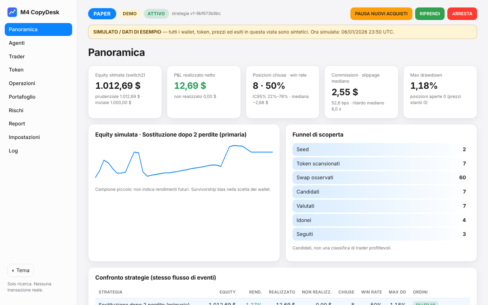
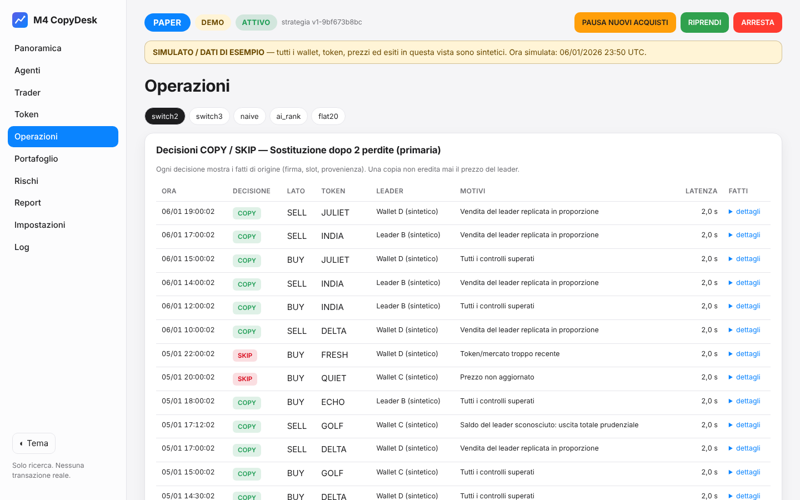
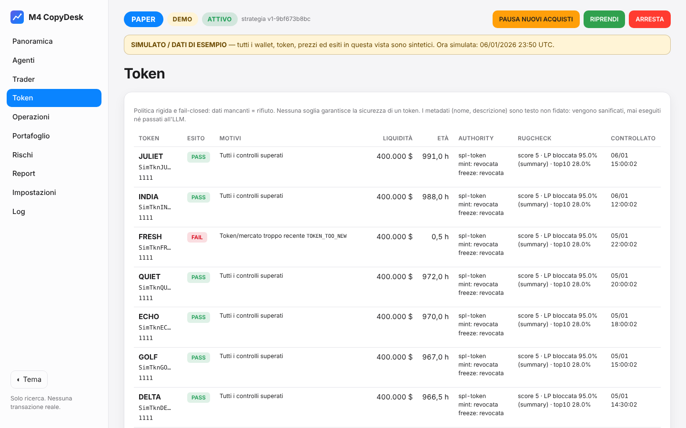
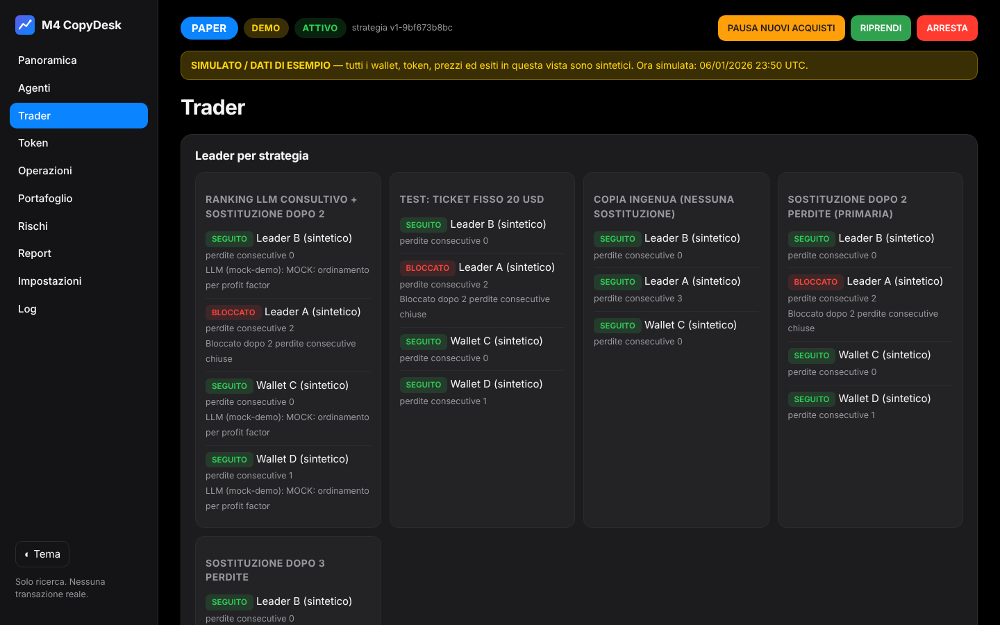

# M4 CopyDesk

Sistema **locale**, multi-agente, a **costo zero** per la *ricerca* sul copy-trading Solana.
Gira su un Mac mini M4 (o qualsiasi macOS/Linux con Python ≥ 3.12) in modalità **PAPER**:
nessuna transazione reale, nessuna chiave di wallet, P&L su capitale **virtuale**.

> ⚠️ Questo è uno strumento di ingegneria e ricerca, **non** una promessa di rendimento.
> Nessuna strategia è dichiarata profittevole. I risultati della demo sono **sintetici**.

## Cosa fa

- **Scoperta** di wallet candidati da indirizzi pubblici seed ed esplorazione limitata degli swap.
- **Analisi trader**: round-trip, P&L realizzato, win rate con IC95%, tempi di detenzione,
  concentrazione, copiabilità, completezza dei dati (metriche ignote = "n/d").
- **Analisi token** fail-closed: authority mint/freeze on-chain, estensioni Token-2022, Rugcheck,
  liquidità, età, concentrazione dei detentori, testo dei metadati trattato come non fidato.
- **Strategie confrontate sullo stesso flusso**: sostituzione dopo 2 perdite (primaria), dopo 3,
  copia ingenua, ranking LLM consultivo, ticket fisso 20 $.
- **Broker PAPER** con quotazione ritardata, slippage avverso, commissioni di rete/priorità/DEX,
  rent, ordini non eseguibili, max chase rispetto al fill del leader.
- **Dashboard italiana** (chiaro/scuro, aggiornamento in tempo reale) con PAUSA / RIPRENDI / ARRESTA.
- **Report giornalieri** in italiano, audit log completo, registro FMEA con test bloccanti.

## Schermate (demo, dati sintetici)

| Panoramica | Operazioni |
|---|---|
|  |  |
| **Token** | **Trader (tema scuro)** |
|  |  |

## App per Mac (.dmg)

Il `.dmg` per Apple Silicon viene compilato su un runner macOS di GitHub Actions
(`.github/workflows/macos-dmg.yml`, gratuito per repository pubblici) o in locale con:

```zsh
packaging/build_macos.sh          # crea build/M4-CopyDesk-<versione>-macOS-arm64.dmg (+ .sha256)
```

L'app vive nella barra dei menu ("M4"): apre la dashboard locale, esegue la demo al primo avvio,
avvia/arresta il motore PAPER, aggiunge wallet pubblici, PAUSA/RIPRENDI, avvio al login, e impedisce
lo stop per inattività mentre il motore gira. Dati in `~/Library/Application Support/M4 CopyDesk/`.
L'app è firmata ad-hoc ma **non notarizzata** (servirebbe un account Apple a pagamento): al primo
avvio usa clic destro → Apri. Istruzioni complete in [packaging/LEGGIMI.txt](packaging/LEGGIMI.txt).
Lo stesso eseguibile funziona da riga di comando:
`"/Applications/M4 CopyDesk.app/Contents/MacOS/M4 CopyDesk" doctor`.

## Installazione da sorgente (macOS, zsh)

```zsh
git clone <URL-del-repository> m4-copydesk && cd m4-copydesk
python3 -m venv .venv && .venv/bin/python -m pip install -e '.[dev]'
source .venv/bin/activate        # rende disponibile il comando `m4desk`
m4desk doctor
```

Requisiti: Python 3.12+. Opzionale: [Ollama](https://ollama.com) con `ollama pull qwen3.5:9b`
(senza LLM il sistema usa la classifica deterministica).

## Avvio rapido: demo offline (nessuna chiave, nessuna rete)

```zsh
m4desk demo                       # ~5 s: scoperta → punteggi → selezione → controlli → acquisti
                                  # simulati → vendite parziali → P&L → cambio trader → report
m4desk dashboard --db demo        # http://127.0.0.1:8765
```

Oppure tutto insieme: `m4desk demo --serve`. Per vedere gli eventi scorrere in dashboard:
`m4desk demo --pace 1` in un terminale e `m4desk dashboard --db demo` in un altro.

Tutto ciò che la demo mostra è etichettato **SIMULATO / DATI DI ESEMPIO**: wallet, token, firme e
prezzi sono inventati (`scripts/generate_demo_fixture.py`, deterministico).

## Modalità PAPER su mainnet (sola lettura)

```zsh
m4desk init                                   # crea config.yaml, .env (0600), data/paper.db
m4desk test-providers                         # prova i provider gratuiti (unico comando di test che usa la rete)
m4desk wallets add <INDIRIZZO_PUBBLICO> --label "nome"
m4desk run --mode paper                       # motore; Ctrl-C per uscire
m4desk dashboard                              # in un altro terminale (DB paper)
```

- Serve solo un **indirizzo pubblico** di partenza. **Mai** chiavi private o seed phrase: il sistema non le usa.
- RPC pubblico Solana: funziona senza chiavi ma risponde spesso `429` (non è production-grade).
  Consigliato: chiave **gratuita** Helius (piano Free, nessuna carta) in `.env` → `HELIUS_API_KEY=...`
  e `providers.use_helius: true` in `config.yaml`.
- Jupiter funziona keyless; una chiave gratuita (`JUPITER_API_KEY`) alza i limiti.
- Se Rugcheck non è disponibile o disabilitato: **stop ai nuovi acquisti** (modalità SOLO OSSERVAZIONE).

## Live con soldi veri (opzionale) e wallet Fomo

Il live è **spento** di default. Se lo attivi, replica con soldi veri gli ordini PAPER eseguiti della
strategia primaria, con importo fisso (0,05 SOL) e tetto giornaliero (0,2 SOL), dopo ispezione e
simulazione di ogni transazione. Può usare la chiave esportata dal tuo wallet Fomo (che quindi vedrai
muoversi nell'app Fomo) oppure, più sicuro, un wallet dedicato. Notifiche sul telefono con **ntfy**.
Guida completa e rischi: [docs/LIVE_CHECKLIST.md](docs/LIVE_CHECKLIST.md).

```zsh
m4desk live import-key      # chiave privata (input nascosto) → Portachiavi di macOS
m4desk live preflight       # tutto deve essere OK (nessuna firma)
m4desk run --mode paper     # in un altro terminale
m4desk live arm             # digita ARMA LIVE (si disarma a ogni riavvio)
m4desk live status | m4desk live disarm | m4desk live forget-key
```

## Comandi (`m4desk --help` è la fonte definitiva)

| Comando | Cosa fa |
|---|---|
| `m4desk doctor [--online]` | verifica Python, dipendenze, configurazione, permessi `.env`, Ollama |
| `m4desk init` | crea `config.yaml`, `.env` (0600, con token dashboard), `data/paper.db` |
| `m4desk demo [--pace S] [--serve]` | demo offline deterministica in `data/demo.db` |
| `m4desk replay <FIXTURE> [--pace S] [--serve]` | replay di uno scenario JSON in `data/replay.db` |
| `m4desk wallets add <INDIRIZZO> [--label L] [--db paper]` | aggiunge un indirizzo pubblico alla watchlist |
| `m4desk wallets list [--db paper]` | elenca la watchlist |
| `m4desk run --mode paper [--with-dashboard]` | avvia il motore PAPER (altre modalità rifiutate) |
| `m4desk dashboard [--host 127.0.0.1] [--port 8765] [--db paper\|demo\|replay\|file.db]` | dashboard locale |
| `m4desk pause [--db …]` | PAUSA NUOVI ACQUISTI (le uscite protettive restano attive) |
| `m4desk resume [--db …]` | RIPRENDI (unico modo di uscire da SAFE/ARRESTA) |
| `m4desk stop [--db …]` | ARRESTA il motore |
| `m4desk status [--db …]` | stato, agenti, equity simulata |
| `m4desk report [--db …] [--day AAAA-MM-GG] [--generate]` | report giornaliero in italiano |
| `m4desk test-providers` | probe dei provider gratuiti (rete, solo letture) |
| `m4desk live import-key\|forget-key\|status\|preflight\|arm\|disarm` | esecuzione REALE opt-in (vedi sopra) |
| `m4desk budget [--db …]` | budget e consumo dei provider |

## Configurazione

- `config.example.yaml` → `config.yaml` (non segreto, commentato in italiano). Limiti di default:
  capitale virtuale 1000 $, max 3 leader, max 3 posizioni, 5% per posizione, 15% di esposizione lorda,
  2% di perdita giornaliera, ticket fisso 20 $ per la strategia di test, max chase 15% (ipotesi di test).
  I limiti rigidi (5%, 15%, 2%, 3, 15% chase) possono solo essere **abbassati**.
- `.env.example` → `.env` (segreti, escluso da git).
- Ogni modifica alle soglie crea una nuova **versione di strategia** (hash) registrata con ogni decisione.

## Avvio automatico su macOS (launchd)

`systemd` non esiste su macOS: si usano LaunchAgent utente.

```zsh
./scripts/install_launchd.sh      # motore (con caffeinate -i) + dashboard, avvio al login, log in data/logs
./scripts/uninstall_launchd.sh
```

Riavvio e sospensione:
- I LaunchAgent partono al login: abilita il login automatico (Impostazioni di Sistema → Utenti e gruppi)
  se il Mac deve ripartire da solo dopo un riavvio.
- `caffeinate -i` impedisce la sospensione per inattività mentre il motore gira. In alternativa:
  Impostazioni di Sistema → Energia → "Impedisci lo stop automatico quando lo schermo è spento",
  oppure `sudo pmset -a sleep 0` (reversibile con `sudo pmset -a sleep 1`).
- Dopo un riavvio il sistema riprende da solo: ordini incompleti annullati, eventi non confermati
  riconsegnati, gap-fill dai checkpoint.

## Test

```zsh
.venv/bin/pytest -q
.venv/bin/ruff check .
```

I test girano con la **rete bloccata** (fixture `no_network`): demo, replay, dashboard e paper broker
non fanno chiamate esterne né firme. Gli adapter reali sono testati su risposte vere catturate in
`tests/fixtures/captured/`.

## Struttura

```
src/m4desk/
  cli.py config.py types.py runtime.py engine.py clock.py
  providers/   base, budget (gate), http, solana_rpc, swap_parser, dexscreener, jupiter, rugcheck, fixtures
  agents/      discovery, trader, token, strategy, positions, audit, supervisor
  services/    events, ledger, risk, safety, paper_broker, llm, trader_metrics, reporting, ingest, strategies
  storage/     db.py (SQLite WAL, SQLAlchemy 2)
  web/         app.py, views.py, templates/, static/ (nessun CDN)
  live/        DISABILITATO / NON IMPLEMENTATO
  data/        demo_scenario.json (SIMULATO)
tests/  examples/  scripts/  docs/
```

## Documentazione

- [docs/ARCHITECTURE.md](docs/ARCHITECTURE.md) — agenti, envelope, ordini a due fasi, contabilità, stati
- [docs/PROVIDERS.md](docs/PROVIDERS.md) — provider verificati, limiti del costo zero, provenienza dati, licenze
- [docs/THREAT_MODEL.md](docs/THREAT_MODEL.md) — minacce e controlli
- [docs/FMEA.md](docs/FMEA.md) — registro dei modi di guasto con test bloccanti
- [docs/INCIDENTS.md](docs/INCIDENTS.md) — procedure per incidenti
- [docs/LIVE_CHECKLIST.md](docs/LIVE_CHECKLIST.md) — prerequisiti della modalità live (solo futuro)
- [PLAN.md](PLAN.md) — fasi e decisioni

## Costi

- **€0 di abbonamenti software/API**: solo provider gratuiti/keyless, ntfy gratuito e un LLM locale.
- In una futura esecuzione reale resterebbero **sempre** i costi di rete Solana, priority fee,
  commissioni DEX/aggregatore, rent degli account, impatto e slippage. In PAPER sono simulati.

## Limiti noti

- Nessuna classifica esaustiva dei trader di Solana: la scoperta è limitata dal budget gratuito.
- Storico pubblico parziale; campioni piccoli; survivorship bias nella selezione dei wallet.
- RPC pubblico lento e con `429`: con Helius free l'esperienza migliora molto.
- Il parser riconosce i principali DEX/aggregatori (Jupiter, Raydium, Orca, Meteora, Pump.fun,
  PumpSwap, Phoenix): altri programmi vengono ignorati (fail-closed).
- Prezzi DEX Screener senza orario nativo: si usa l'orario del fetch.
- Il P&L simulato può essere migliore del reale (MEV, transazioni fallite, latenza reale).
- Live: verificato con Jupiter/RPC simulati e con transazioni Jupiter reali ispezionate e simulate senza
  firma; la prima esecuzione firmata avviene sul tuo Mac con i tuoi fondi: parti con i limiti minimi.

## Risoluzione problemi

| Problema | Soluzione |
|---|---|
| `command not found: m4desk` | `source .venv/bin/activate` oppure usa `.venv/bin/m4desk` |
| La dashboard dice "host non consentito" | apri `http://127.0.0.1:8765` (non l'IP di rete) |
| Pulsanti → "Comando rifiutato (403)" | ricarica la pagina; verifica `M4DESK_DASHBOARD_TOKEN` in `.env` e riavvia la dashboard |
| `CIRCUIT_OPEN` / `429` frequenti | normale con l'RPC pubblico: attendi, riduci `discovery.max_candidates` o usa Helius free |
| "Ollama non raggiungibile" | `ollama serve` e `ollama pull qwen3.5:9b`; facoltativo |
| Banner rosso "Modalità sicura" | vedi pagina Rischi e [docs/INCIDENTS.md](docs/INCIDENTS.md), poi `m4desk resume` |
| Nessun leader selezionato | i candidati non superano le soglie (`min_round_trips`, `min_score`): è il comportamento atteso |
